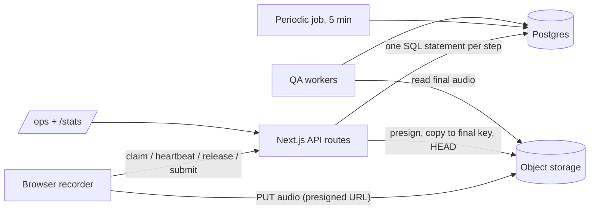
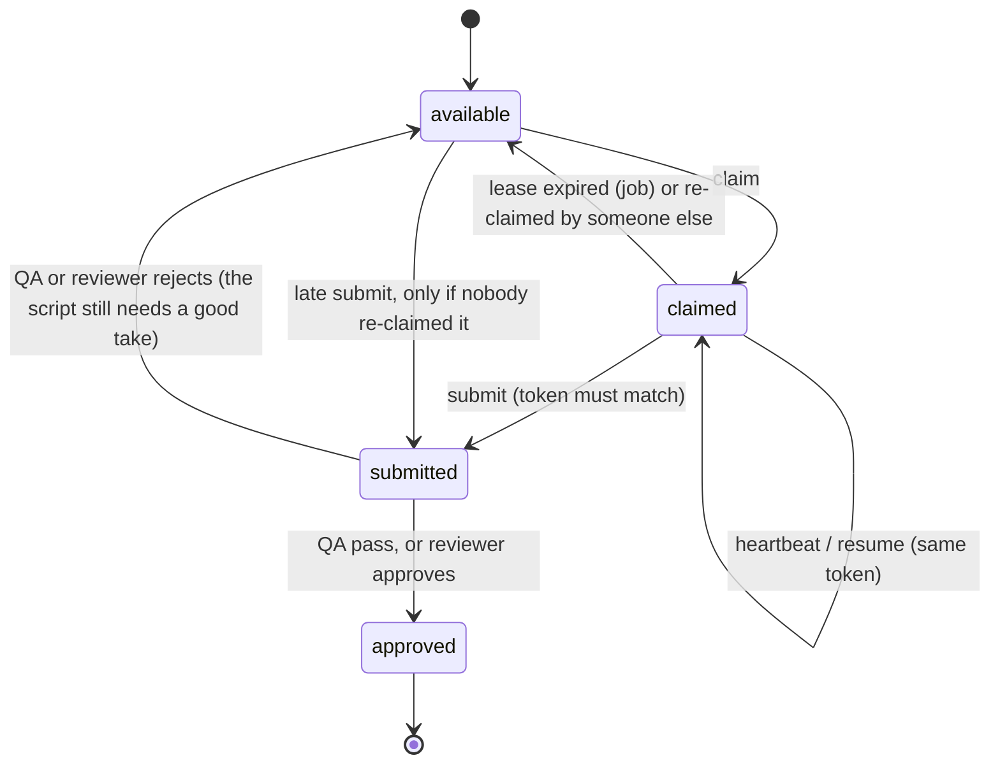
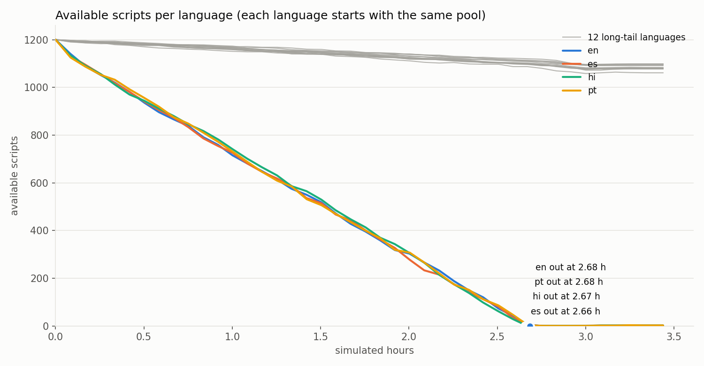
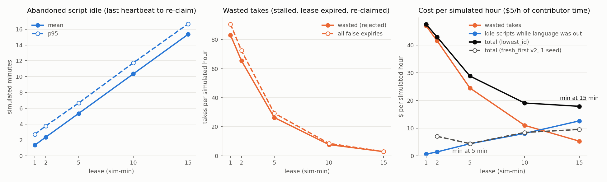
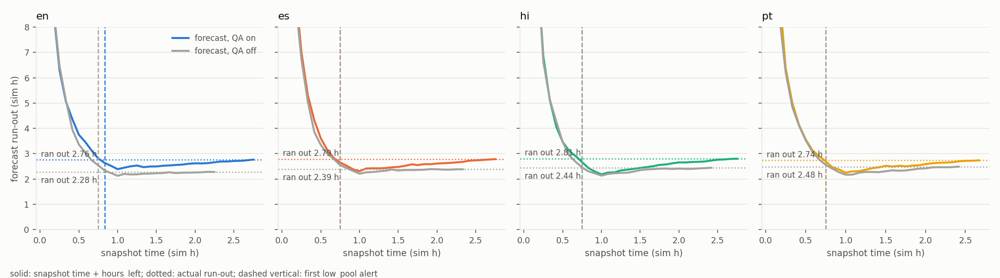

# Script assignment

Hand each recording script to exactly one contributor at a time, get abandoned scripts back quickly, and never lose or double-pay a recording. A small but real version: Next.js + Postgres + S3-compatible storage, with a browser recorder, an automatic QA step, an ops view, a test suite, a 300-contributor simulation, and experiments that measure the tradeoffs.

<!-- TLDR:START -->
**TL;DR**
- **The surprise.** My first version handed out the lowest free script id. In the simulation, that meant a stalled contributor's expired script was re-taken within seconds in busy languages, so **279 of 288 late takes were thrown away**. Handing out never-held scripts first accepts **243 of 275**: wasted contributor time drops from ~93 to ~13 hours per 3 simulated hours, with the same number of recordings (both runs QA off). It's now the default.
- **QA checks the take matches the script** (Whisper, run locally). The script check alone, cross-validated on 2,520 synthetic readings in 14 languages: rejects 90% of wrong readings and wrongly rejects 0.6% of correct ones. QA as a whole (2,580 readings, 15 languages) leaves **3% of takes for a person** instead of all of them. The length rules behind part of that were calibrated on the same synthetic voices, so expect more on real audio.
- **0 scripts handed out twice** across 7,267 leases while 300 simulated contributors closed tabs, refreshed, opened second tabs and stalled, plus 129 tests against the real Postgres and storage.
- **Capacity:** one Postgres + one Node process handles ~57 claims/s (57x the ~1 claim/s target traffic) at p95 under 50 ms with a 20-connection pool, and 75/s at p95 37 ms with 50 connections; the ceiling is the pool, not Postgres. The 4 popular languages run dry at ~2.7 h, and the low-pool alert gives ~2 h of warning.
- **How:** every claim is a lease with a fencing token: one atomic `FOR UPDATE SKIP LOCKED` claim, heartbeats to extend it, and expired leases count as free in the claim query itself.
<!-- TLDR:END -->

## The problem

Contributors record scripted audio in the browser. Each script should get exactly one good recording, so while someone is recording a script nobody else may get it. But a browser can vanish at any moment (closed laptop, dead battery, lost signal) without telling the server, so a held script must come back on its own. Target traffic (design assumptions): ~2,000 registered contributors, ~300 online at once, 16 languages with ~1,200 scripts each, ~80% of contributors in 4 popular languages, ~3-minute recordings (~17 MB as 48 kHz 16-bit WAV). One Postgres, a web server, object storage and a periodic job.

## Design



**Core ideas**
1. **Every claim is a lease** (`lease_expires_at`) with a fresh random **claim token**.
2. **Claim is one atomic statement** with `FOR UPDATE SKIP LOCKED`: two contributors can never get the same row, and concurrent claimers in a popular language each take a different row instead of queueing on one.
3. **The browser heartbeats** every 30 s to extend the lease. Tab-close events are unreliable (especially on mobile), so **lease expiry is the real guarantee**; the `pagehide` release only speeds recovery up.
4. **Expired leases count as free inside the claim query**, so an abandoned script is claimable the moment its lease ends. The 5-minute job is cleanup, stats and alerts only; correctness doesn't depend on it.
5. **The claim token is a fencing token.** Heartbeat, upload URL and submit must present it, so a stale tab (or a contributor whose script was re-claimed after a long stall) can't touch a script that is now someone else's.
6. **Audio goes straight to storage** with a presigned PUT (17 MB never passes through the web server). Submit copies it to a key no URL can write, checks the copy, then marks the script submitted.
7. **The database enforces the invariants:** one claimed script per contributor (partial unique index), one live recording per script (partial unique index on non-rejected recordings), and a `CHECK` tying `status = 'claimed'` to its lease fields.
8. **One clock:** every time comparison uses Postgres `now()`. The browser's countdown starts from the server's remaining seconds.

**The claim** (`lib/assign.ts`), after resume/revive checks. By default it first takes a never-held script from a partial index (`status = 'available' AND prev_token IS NULL`), and only then runs this query, which also takes expired leases:

```sql
WITH pick AS (
  SELECT id, status AS old_status, claim_token AS old_token, claimed_by AS old_by
  FROM scripts
  WHERE language = $2
    AND (status = 'available' OR (status = 'claimed' AND lease_expires_at <= now()))
  ORDER BY id
  LIMIT 1
  FOR UPDATE SKIP LOCKED
)
UPDATE scripts s
SET status = 'claimed', claimed_by = $1, claim_token = gen_random_uuid(),
    claimed_at = now(), lease_expires_at = now() + make_interval(secs => $3),
    prev_token = NULL, prev_claimed_by = NULL, times_claimed = s.times_claimed + 1
FROM pick
WHERE s.id = pick.id
RETURNING s.id, s.body, s.claim_token, s.lease_expires_at, pick.old_status, pick.old_token, pick.old_by;
```

### Lifecycle



A recording goes `pending_checks → approved | rejected | needs_review`, `needs_review → approved | rejected`, `approved → paid`. Earnings show as **estimated** until approved.

### Contributor behaviors it handles

| What happens | Result |
|---|---|
| Refresh, or a second tab | Same script, same token (`resumed`), and the lease is extended |
| Close the tab | `pagehide` sends a beacon. The lease is shortened to a grace of 1.5 heartbeats: another tab or device still open heartbeats it back; otherwise the script frees itself |
| Tab vanishes (no beacon) | The lease expires and the next claim in that language takes it |
| Network stall longer than the lease | When the contributor returns: if nobody took the script, they get it back with the **same token** (revive), and the take they already uploaded is still valid; if someone did, the old token is fenced off (409) |
| Submit retried, or sent twice at once | One recording; every call returns it (idempotent per token) |
| Upload succeeded but submit failed | Retry submit; leftover uploads are found by the orphan sweep |

## Decisions and tradeoffs

| Decision | Why | Tradeoff / alternative |
|---|---|---|
| Lease + heartbeat | The browser can vanish without telling us | Short lease = fast recovery, but network stalls lose scripts. Measured below |
| Expired = free in the claim query | No waiting for the 5-min job | Rows can look `claimed` while actually free; the job tidies them |
| `SKIP LOCKED` | No blocking under contention in popular languages | Not strictly FIFO; fine here |
| Fencing token | A stale tab can't overwrite a newer claim | One more field to pass around |
| Resume / revive own lease | Refresh, second tab and "back after a stall" keep the same script and the take they already made | A contributor can't hold two scripts (intended) |
| Soft release (grace) instead of freeing at once | All of a contributor's tabs/devices share one token; a hard release from one would free a script another is still recording | A politely closed script frees after ~45 s instead of instantly |
| Accept a late submit if not re-claimed | Don't waste a finished recording (contributor time + pay) | If re-claimed, reject and say so. How often that happens depends on claim order (measured below) |
| Never-held scripts first (`fresh_first`) | Gives a stalled contributor's expired script time to come back; 87% less contributor time lost | Abandoned scripts wait behind fresh ones (free until a language runs low). Two index scans instead of one |
| Presigned upload, copy to a final key on submit | Server stays light; the approved audio can't be swapped through a still-valid upload URL | One server-side copy per submit; orphan uploads need a sweep |
| QA before pay; reviewers only see borderline takes | Clear passes and clear fails don't need a human | Thresholds need tuning on real data |
| Postgres only (no Redis) | ~1 claim/s; one database is plenty and simpler to run | At ~100x: see Scaling |

**Alternatives considered**
- *Session-level advisory locks:* the lock dies with the DB connection, not with the browser tab, so it doesn't model "the contributor is still recording".
- *Redis `SET NX EX`:* fast, but a second system to keep consistent with Postgres; not needed at this traffic.
- *Pre-assigning scripts to contributors:* wastes scripts on people who never show up.
- *Relying only on the 5-minute job:* abandoned scripts would sit idle up to 5 min longer than the lease.

**How others do it**
- *Mozilla Common Voice* doesn't lock at all: many people record the same sentence on purpose (up to 15 clips), with a per-user list of handed-out sentences and upvote/downvote validation. Here each script needs exactly one active recorder, so an exclusive lease is required.
- *MTurk* and *Label Studio* use the same timeout idea (an assignment duration / task reservation that returns the task when it lapses) and face the same tradeoff: too short duplicates work, too long blocks tasks. That is the lease experiment below.
- This build: an exclusive lease, heartbeats so the lease can stay short, and a fencing token so a lapsed holder can't write.

## Failure modes

| If... | Then |
|---|---|
| The tab vanishes | The lease expires (10 min); the next claim takes the script. No job needed |
| The app server restarts | Nothing is lost: it's stateless and leases live in Postgres. Clients' next heartbeat succeeds |
| Postgres is briefly down | Claims and heartbeats get 503; the client retries with backoff. A lease that lapses meanwhile is revived on the next claim if nobody took the script |
| The DB pool is exhausted | Requests fail fast with 503 (connect timeout) instead of queueing forever |
| The upload succeeds but submit fails | Submit is idempotent: retry. A never-submitted upload is found by the orphan sweep |
| Submit succeeds but the response is lost | The retry returns the same recording |
| The browser's clock is wrong | Only Postgres time is used; the countdown comes from the server's remaining seconds |
| A QA worker crashes mid-batch | Its rows are held by session advisory locks, which Postgres frees when the connection drops; another worker picks them up |
| Someone edits a WAV header or swaps audio after submit | Inconsistent headers and unexpected sample rates are rejected; submitted audio lives at a key no URL can write |

## Automatic QA

**Did they read the script?** The audio checks below can't tell whether a contributor read the right sentence, which otherwise means a person listens to every take. With `WHISPER_URL` set, QA transcribes each take with whisper.cpp (ggml-small, local) and compares it with the script by character error rate, with thresholds per language: approve, reject as `wrong_script`, or send to review with the transcript shown to the reviewer. Measured on 2,520 synthesized takes in 14 languages (macOS voices: correct readings, a different sentence, half the sentence, the wrong language, noisy and fast readings), with thresholds chosen on half of each language's sentences and scored on the other half:

| Script check alone (14 languages) | Approved | To review | Rejected |
|---|---|---|---|
| Correct readings (1,260) | 96.6% | 2.8% | **0.6%** (wrongly) |
| Wrong readings (1,260) | **0.2%** (slipped through) | 9.6% | **90.2%** |

At a realistic 95% correct / 5% wrong mix the script check alone sends 3.1% of takes to a person. The audio rules had been tuned for the original ~3-minute takes and, on one-sentence scripts, sent a third of correct readings to review on their own ("under 5 s", "mostly silent"); they now judge length and silence against the script's expected reading time. **QA as a whole** (audio checks + script check, 2,580 takes, 15 languages, Bengali on audio checks only) at the same mix: **91.9% approved, 3.0% to a person, 5.1% rejected** (before that change: 61.5 / 33.5 / 5.0); wrong readings: 1.7% slip through, 8.1% to review, 90.2% rejected. The per-language reading pace behind the length rules was calibrated on the same synthetic voices, so this part is in-sample; the script-check thresholds above are cross-validated. Transcription is ~0.3 s per sentence (p95 0.9 s) on a laptop. Bengali is off (Whisper-small can't transcribe it reliably) and Swahili is review-only (no voice to test with). TTS voices are cleaner than real contributors, so real accents, children and cheap mics will move these numbers; the per-language table and caveats are in [results/script-check.md](results/script-check.md).

After submit, QA workers (`lib/qa.ts`, `lib/checks.ts`) decode the WAV and check what speech-data buyers reject: length against the script's expected reading time, silence between the first and last word, speech level (inaudible / quiet), clipping (runs of clipped samples, so a single loud peak passes), leading/trailing padding, long internal pauses, a cut-off ending, and exact or near-duplicate audio. A clear fail rejects the take and puts the script back in the pool; a borderline take goes to the review queue on `/ops`; everything else is approved with its pay. Several workers can run at once: rows are taken with `SKIP LOCKED` plus a per-row advisory lock, and the duplicate check and the decision run under a per-audio-hash lock so two identical uploads can't both be approved.

Verdicts on synthetic takes (`npx tsx scripts/qa-demo.ts`; each is judged against the length of the script it reads; the same variants at 1 kHz get identical verdicts):

| Take | Verdict | Why | Duration | Silence | Speech level | Clipped |
|---|---|---|---|---|---|---|
| normal | pass | | 11.1 s | 24% | -20 dB | 0% |
| silent / digital zero / whisper | fail | silent | 10-11 s | 100% | below gate | 0% |
| hiss, no speech | fail | inaudible | 10.0 s | 0% | -47 dB | 0% |
| quiet | review | quiet | 11.1 s | 31% | -40 dB | 0% |
| heavily clipped | fail | distorted | 11.1 s | 24% | -1 dB | 48% |
| mildly clipped | review | clipping | 11.1 s | 24% | -9 dB | 0.4% |
| far shorter than the script (0.15x) | fail | truncated | 1.9 s | | | |
| somewhat short (0.35x) | review | truncated | 4.2 s | | | |
| 5 s padding each end | review | padded | 20.0 s | 58% | | |
| 20 s padding each end | fail | padded | 50.0 s | 83% | | |
| 8 s pause mid-take | review | long_pause | 19.1 s | 56% | | |
| cut off mid-word | review | truncated | 10.6 s | 20% | | |
| 3.5x as long as the script | review | lengthened | 31.1 s | | | |
| 7x as long as the script | fail | lengthened | | | | |

## Results

Full reports: [results/results.md](results/results.md) (simulation + invariant checks), [results/experiments.md](results/experiments.md), [results/loadtest.md](results/loadtest.md). Everything below is measured on a laptop; setups are in the reports.

### Simulation: 300 contributors, 3 simulated hours (seed 42, defaults)

Real HTTP API, time scaled 60x (a 10-min lease is 10 real seconds). Sessions mix seven behaviors: normal (68%), tab vanishes (10%), polite close (5%), refresh (6%), two tabs (4%), network stall longer than the lease (4%), double submit (3%).

| Check | Result |
|---|---|
| Scripts handed out twice (overlapping live leases, rebuilt from the audit log) | **0** of 7,267 leases |
| Scripts with two live recordings | **0** |
| Late submit accepted after someone else re-claimed / rejected when nobody had | **0 / 0** |
| Refresh / second tab got the same script back | 465 of 465 / 292 of 292 |
| Double submit produced exactly one recording | 241 of 241 |
| Heartbeating sessions that lost their lease | 0 |
| Vanished tab → script claimable again | 10.0 min after the last heartbeat (= lease) |
| Late takes after a stall: accepted / rejected | 265 / 25 (QA on; the claim-order runs below had QA off, hence 243 / 275 there) |
| QA: approved / rejected (silent, too short, distorted) / review | 6,175 / 776 / 0; every rejection matched the audio it was given. The simulation's takes are synthetic tones with injected defects and the script check is off; the 3% review figure comes from the script-check evaluation below |
| Approved audio | 318 h = $1,586 at $5/approved hour |
| Popular languages ran out | 2.66-2.68 h; no long-tail language ran out |



### Lease length (cost of idle scripts vs takes lost to network stalls)

Stall lengths are fixed across leases (lognormal, median 3 min), so a shorter lease really does cause more false expiries. Cost = contributor time on rejected takes + abandoned scripts idle while their language had run out, both valued at an assumed $5/h of contributor time. Lowest-id claim order, 2 seeds, 6 simulated hours per lease:

| Lease | 1 min | 2 min | 5 min | 10 min | 15 min | 10 min, no heartbeat |
|---|---|---|---|---|---|---|
| Abandoned script idle (mean) | 1.4 min | 2.4 min | 5.3 min | 10.3 min | 15.3 min | 10.3 min |
| Takes lost to stalls | 499 | 393 | 158 | 46 | 17 | **992** |
| Cost per hour | $47.60 | $43.02 | $28.86 | $19.09 | **$17.90** | $185 |

The no-heartbeat column is a sanity check, not a finding: without heartbeats any session longer than the lease loses its script by design (915 of those 992 were ordinary long sessions, not stalls). The model and the simulation agree: the number of late submits tracks the predicted number of stalls longer than the lease (e.g. 544 vs 540 at 1 min, 51 vs 39 at 10 min).



**With the default never-held-first order the picture changes:** stalls barely lose takes at any lease (10 / 3 / 2 / 0 at 2 / 5 / 10 / 15 min), so a shorter lease wins on recovery: $4.38/h at 5 min vs $8.43 at 10 min (one seed). I kept the default at 10 min: browsers throttle timers in background tabs, so heartbeats can arrive late, and the extra margin costs about $4 per hour.

### Claim order

Same seed, QA off. v1 only reordered rows still marked `claimed`; the 5-min job turned expired leases back into ordinary `available` rows, so it barely helped. v2 also held back rows the job had reset, but sorted every free row per claim (37.6 ms on 100k scripts per language). v3 (shipped) does the same with two index scans (0.09 ms).

| | lowest id | never-held first v1 | v2 | **v3 (default)** |
|---|---|---|---|---|
| Late takes accepted | 9 / 288 | 41 / 279 | 246 / 278 | **243 / 275** |
| Contributor time lost per 3 h | 93 h | 82 h | 12 h | **13 h** |
| Recordings | 6,487 | 6,525 | 6,532 | 6,499 |

### Load

Open-loop, real time, one Node process, a 20-connection pool (run on the build before the v3 claim query; v3's picks are index scans, 0.09-0.13 ms in Postgres):

| Claims/s | 1 | 10 | 57 | 75 | 75, pool of 50 | 100 target (91 achieved) |
|---|---|---|---|---|---|---|
| Claim p95 | 24 ms | 16 ms | **19 ms** | 1,111 ms | **37 ms** (13 errors of 25,496) | 5,099 ms (21 errors) |

All claims in one hot language: p95 22-31 ms. Directly in SQL with 32 concurrent claimers, `SKIP LOCKED` did 4,142 claims/s at p95 8 ms vs 1,836/s at p95 43 ms with plain `FOR UPDATE`.

### Forecast

The job forecasts `hours_left = available / claims per hour` per language and alerts under 2 h. The alert fired 1.93-2.06 h before each popular language ran out. QA rejections refill the pool, so the forecast errs slightly early; without them it errs late (1.5-1.7 h of warning), so if adding scripts takes longer than that, raise the threshold.



### Bugs the tests, simulation and an independent review found (all fixed)
- A pool deadlock: failed heartbeats took a second connection while holding one; enough at once froze the server.
- A Postgres deadlock between the expiry job and a claim for the same contributor (found by the 1-minute-lease run).
- A resume that didn't extend the lease, so a returning contributor could lose the script before their first heartbeat.
- A hard release from one device freeing a script another device was still recording (now a soft release).
- Two identical uploads both approved and paid (QA duplicate check raced across workers).
- A WAV header edited to a lower sample rate reading as 6x the duration, and pay.

## Scaling

Today: ~1 claim/s and ~10 heartbeats/s. Measured: ~57 claims/s plus ~620 heartbeats/s at claim p95 19 ms. At 75/s the 20-connection pool saturates (p95 1.1 s) while Postgres averages ~1 active backend: each claim holds a connection across ~7 round trips while the one Node process is busy. A pool of 50 brought p95 back to 37 ms.

What breaks first, and what I'd change:
1. **Round trips per claim.** Fold the claim into one SQL function (or one statement) so a connection is held for one round trip, and run more app processes behind PgBouncer.
2. **Heartbeat writes**: at 100x that's ~1,000 row updates/s plus an audit-log insert each. Fix: log heartbeats only on state changes (or sample them), and put PgBouncer in front so many app servers share few connections.
3. **The audit log grows fastest.** Partition `claim_events` by day and drop or archive old partitions.
4. **Hot languages.** `SKIP LOCKED` keeps claims from queueing, but at very high rates partition `scripts` by language, or pre-fetch a small batch of candidate ids per language into Redis and keep Postgres as the source of truth for the lease.
5. **QA CPU.** Workers already scale horizontally; move them off the web tier.

## What I'd do next
- Quota/priority-based script selection (coverage targets per language, speaker diversity)
- Resumable multipart uploads for bad connections (only useful above ~5 MB parts, so for long takes)
- Test the script check on real contributor audio (accents, children, cheap mics) and a larger Whisper model for the languages where small is weak (Bengali, Korean)
- Per-contributor abandonment cool-downs (the job already lists high abandoners)
- A payout ledger (append-only), instead of a `paid` status on the recording
- A `qa_attempts` column so a recording that keeps failing on a storage error goes to review instead of being retried forever

## Run it

```bash
cp .env.example .env            # set PG_PORT/DATABASE_URL if 5432 is taken
docker compose up -d            # Postgres 16 + MinIO + bucket
npm install
npm run seed                    # 2,000 contributors, 16 languages x 1,200 scripts
npm test                        # 129 tests against the real Postgres + MinIO
npm run dev                     # http://localhost:3000/record, /stats, /ops
npm run jobs                    # the periodic job (cleanup, stats, alerts)
npm run qa                      # the QA worker (the script check is on if WHISPER_URL is set:)
npm run whisper                 # whisper.cpp server; needs `brew install whisper-cpp` + ggml-small in ~/.cache/whisper
WHISPER_URL=http://127.0.0.1:8178 npm run qa
npm run script-eval             # re-measure the script check -> results/script-check.md
npm run sim && npm run check    # 300-contributor simulation -> results/results.md
npm run experiments             # lease sweep, claim order, forecast -> results/experiments.md
```

### Watch the invariant hold live

```bash
npm run build && LEASE_SECONDS=60 HEARTBEAT_SECONDS=5 npm start   # short lease so expiry is visible
npm run jobs & npm run qa &
npm run storm -- --seconds 90   # ~150 simulated contributors (ids >= 100) hit the running app
```

Open `/ops` while it runs. The **Live** card recomputes "handed out twice" from the audit log every 1.5 s (the same interval rules as the offline checker), next to claims, expiries, late accepts and QA verdicts. The **lease timeline** shows every recent script as a row: each holder's lease with heartbeat ticks, the lease still ahead, and how it ended (submitted, released, expired, revived) with an arrow to the next holder. Record a script yourself in the middle of it. `/findings` has the measured results and charts.

`npm run demo -- race sw` leaves one script in a language so two browser windows can race for it (one wins, the other is told none are left); `npm run demo -- low es 10` brings a pool near empty for the low-pool highlight on `/stats`.

The contributor id comes from an `x-contributor-id` header (or a picker on `/record`) as a stand-in for real auth. `scripts/smoke.sh` walks the API with curl.

## Layout

```
db/schema.sql           tables, invariant indexes, audit log
lib/assign.ts           claim / heartbeat / release / upload-url / submit
lib/jobs.ts             periodic job: cleanup, pool stats, forecast + alerts, orphan + abandonment sweeps
lib/review.ts           recording transitions: approve, reject, review, pay
lib/checks.ts, qa.ts    automatic audio checks + the QA worker loop
lib/transcribe.ts, scriptmatch.ts   speech-to-text client + script match (WER/CER, per-language thresholds)
app/api/**              HTTP routes; app/record, app/stats, app/ops, app/findings pages
lib/ops.ts, timeline.ts ops queries, the live invariant check, the lease timeline
db/sentences.ts         original read-aloud sentences in 16 languages
public/wav-worklet.js   AudioWorklet that captures raw PCM for the 48 kHz WAV
tests/**                129 tests, real Postgres + MinIO
sim/**                  simulation, invariant checker, experiments, load test, storm
results/**              generated reports and charts
```
