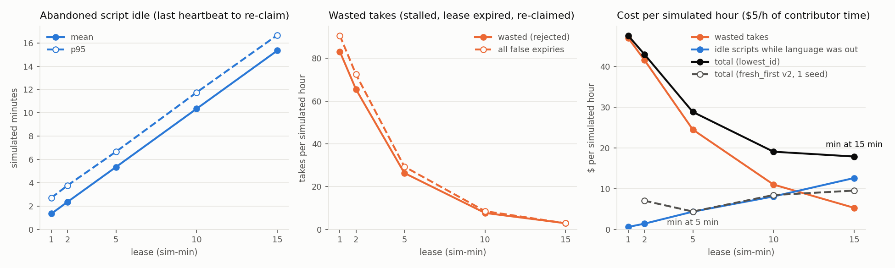
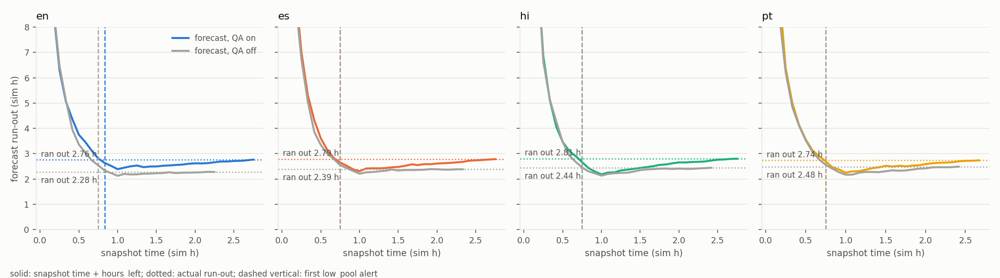

# Experiments

Generated by `npm run experiments` (lease sweep, claim order, forecast) and `npx tsx --env-file=.env sim/loadtest.ts` (load test). Every number is measured from runs on this laptop (10-core Apple Silicon, one Next.js `next start` process, Postgres 16 and MinIO in Docker). Simulated runs use the same simulator as results.md (300 online, 16 languages x 1,200 scripts, 3 simulated hours at 60x, real HTTP API); setup differences are listed per experiment.

## Summary

1. **Lease: recommend 5 minutes with the current `fresh_first` claim order** (heartbeat 30 s), or 15 min if the order stays `lowest_id`. Cost per simulated hour = wasted takes (contributor time from claim to rejection) + abandoned scripts idle while their language had run out, both at $5/h. With lowest_id: 1 min $47.60, 2 min $43.02, 5 min $28.86, 10 min $19.09, 15 min $17.90 (wasted takes 499 / 393 / 158 / 46 / 17 in 6 sim-h; shorter leases recover abandoned scripts faster but lose more takes to network stalls). With fresh_first v2 an expired lease waits at the back of the queue, so wasted takes nearly vanish (10 / 3 / 2 / 0 in 3 sim-h) and the shorter lease wins on faster recovery after run-out: 2 min $7.03, 5 min $4.38, 10 min $8.43, 15 min $9.52 (one seed each, measured on the v2 build; v3 behaves the same: 243/275 vs 246/278 late submits accepted in the claim-order runs). Without heartbeats a 10-min lease wastes 992 takes instead of 46.
2. **Claim order: make `fresh_first` (v3, current code) the default.** Late submits after a stall accepted: lowest_id 9/288, v1 41/279, v2 246/278, v3 243/275; contributor time lost $465.62 -> $62.79 per 3 sim-h; same recordings (6487 vs 6499); the v3 pick is an index scan (0.09 ms in Postgres on 100k scripts per language). v1 failed because the 5-min job turned expired leases back into ordinary 'available' rows; v2 fixed that but sorted every free row per claim (37.6 ms per claim on 100k rows per language); v3 does the same thing with two index scans. Cost: abandoned scripts wait at the back of the queue (idle mean 10.34 -> 35.36 min), free until never-claimed scripts run out.
3. **Load:** one Postgres + one Node process handles **~57 claims/s** (57x today's 1 claim/s, plus 617 heartbeats/s) **before claim p95 > 50 ms** on this laptop (p95 19.3 ms there; 1111.5 ms at 75/s). The limit is the 20-connection pg pool waiting on the single Node event loop (connections idle in transaction), not Postgres: at 75/s only 1.1 backends were executing on average, and a 50-connection pool brought p95 back to 37.0 ms. 1x: claim p95 23.8 ms; 10x: 15.9 ms; 100x: 5099.3 ms with 21 failed requests.
4. **Forecast: the low_pool alert gave 1.93-2.06 h of warning** before each popular language ran out in the QA-on baseline (alert threshold 2 h; forecast error at the alert -0.14 to -0.04 h, early because QA rejections refill the pool). Without QA refills the forecast was late instead and the warning shrank to 1.53-1.73 h.

## 1. Lease length sweep

**Setup.** Leases 1, 2, 5, 10, 15 sim-min with heartbeats every 30 sim-s, plus 10 min without heartbeats. 2 seeds (42, 43) per lease, results pooled (6 simulated hours of arrivals per lease). Claim order `lowest_id`. QA off (`--no-qa`): QA doesn't touch leases, and without it no rejected takes refill the pool, so pools run out a little earlier than in results.md. Stalls use a **fixed** length distribution for every lease: lognormal in simulated minutes, median 3, sigma 0.8 (p95 11.2, capped at 30), starting 10-50% into the session (4% of sessions stall). The default sim instead stalls for 1.1-2.5x the lease, which would make every stall a late submit at any lease. After the stall the contributor submits without re-claiming.

Definitions. *Idle time*: a vanished tab's script, from its last heartbeat until someone else claims it (only abandoned leases; the owner coming back is excluded, same as results.md). *False expiry*: a contributor who was still recording but whose lease expired during a stall (= late submit). *Wasted take*: a false expiry whose script was re-claimed before the submit, so the take is rejected (409). Lost time = claim to rejection, valued at $5/h.

| Lease | Abandoned scripts (re-claimed / still idle at end) | Idle mean (min) | p50 | p95 | Idle script-min per sim-h | Stalls | Stalls > lease (expected from the stall model) | False expiries (late submits) | ... accepted late | **Wasted takes** (popular / tail) | Contributor-min lost | $ lost | $ lost per sim-h | Heartbeat p95 (ms, real) | Heartbeating sessions that lost the lease | Handed out twice |
|---|---|---|---|---|---|---|---|---|---|---|---|---|---|---|---|---|
| 1 min | 1564 / 9 | 1.39 | 1.12 | 2.81 | 388 | 593 | 543 | 641 | 103 | **538** (408 / 130) | 3729 | $310.78 | $51.80 | 119 | 619 | 0 |
| 2 min | 1499 / 13 | 2.37 | 2.12 | 3.74 | 622 | 571 | 396 | 419 | 41 | **378** (299 / 79) | 2915 | $242.91 | $40.48 | 75 | 0 | 0 |
| 5 min | 1290 / 28 | 5.34 | 5.11 | 6.66 | 1234 | 575 | 150 | 176 | 18 | **158** (121 / 37) | 1766 | $147.13 | $24.52 | 79 | 0 | 0 |
| 10 min | 1047 / 36 | 10.35 | 10.10 | 11.75 | 1918 | 583 | 39 | 51 | 5 | **46** (34 / 12) | 793 | $66.05 | $11.01 | 92 | 0 | 0 |
| 15 min | 863 / 33 | 15.34 | 15.10 | 16.67 | 2346 | 567 | 13 | 17 | 0 | **17** (15 / 2) | 380 | $31.70 | $5.28 | 63 | 0 | 0 |
| 1 min @20x | 1541 / 14 | 1.34 | 1.11 | 2.71 | 376 | 590 | 540 | 544 | 45 | **499** (385 / 114) | 3385 | $282.05 | $47.01 | 23 | 0 | 0 |
| 2 min @20x | 1480 / 18 | 2.36 | 2.11 | 3.77 | 638 | 585 | 406 | 435 | 42 | **393** (298 / 95) | 2998 | $249.80 | $41.63 | 15 | 0 | 0 |
| 10 min, no heartbeat | 1296 / 28 | 10.32 | 10.11 | 11.58 | 2329 | 601 | 40 | 1149 | 157 | **992** (804 / 188) | 13326 | $1110.48 | $185.07 | n/a | 0 | 0 |
| 2 min, fresh_first v2 | 165 / 23 | 23.81 | 16.98 | 71.40 | 1504 | 291 | 202 | 221 | 211 | **10** (10 / 0) | 185 | $15.42 | $5.14 | 87 | 0 | 0 |
| 5 min, fresh_first v2 | 148 / 35 | 26.79 | 18.76 | 82.40 | 1602 | 283 | 74 | 88 | 85 | **3** (3 / 0) | 28 | $2.36 | $0.79 | 127 | 0 | 0 |
| 10 min, fresh_first v2 | 126 / 25 | 31.82 | 21.43 | 81.63 | 1679 | 287 | 19 | 24 | 22 | **2** (2 / 0) | 27 | $2.21 | $0.74 | 185 | 0 | 0 |
| 15 min, fresh_first v2 | 104 / 29 | 35.45 | 20.46 | 95.80 | 1548 | 281 | 6 | 11 | 11 | **0** (0 / 0) | 0 | $0.00 | $0.00 | 121 | 0 | 0 |

**Cost model (stated assumption).** A wasted take costs the contributor's time from claim to rejection, at $5/h (measured above). An idle abandoned script costs nothing while its language still has other free scripts: whoever wants one gets another. Once its language has run out it costs about one contributor-minute per script-minute, because someone who would have recorded it is told "no scripts left". So an idle script-minute is valued at $0.083 (= $5/h) if its language was already out at that moment (measured per script from its idle interval and the language's first "empty"), and $0 otherwise. The last column is a loose upper bound that charges every idle minute as if the pool were always empty.

| Lease | Wasted-take $/h | Idle script-min/h (all) | ... of which while the language was out | **Total $/h (measured model)** | Total $/h if every idle minute cost $5/h (upper bound) |
|---|---|---|---|---|---|
| 1 min @20x | $47.01 | 376 | 7 | **$47.60** | $78.34 |
| 2 min @20x | $41.63 | 638 | 17 | **$43.02** | $94.78 |
| 5 min | $24.52 | 1234 | 52 | **$28.86** | $127.32 |
| 10 min | $11.01 | 1918 | 97 | **$19.09** | $170.80 |
| 15 min | $5.28 | 2346 | 151 | **$17.90** | $200.78 |
| 2 min, fresh_first v2 | $5.14 | 1504 | 23 | **$7.03** | $130.47 |
| 5 min, fresh_first v2 | $0.79 | 1602 | 43 | **$4.38** | $134.32 |
| 10 min, fresh_first v2 | $0.74 | 1679 | 92 | **$8.43** | $140.69 |
| 15 min, fresh_first v2 | $0.00 | 1548 | 114 | **$9.52** | $129.03 |

**Interpretation.** Idle time is the lease plus a short wait for the next claimer (mean 0.34-0.36 min over the lease), so it grows one-for-one with the lease. False expiries follow the stall-length distribution: the measured count of late submits tracks the model's expected number of stalls longer than the lease (e.g. 1 min: 544 vs 540; 2 min: 435 vs 406; 5 min: 176 vs 150; 10 min: 51 vs 39; 15 min: 17 vs 13); the small excess comes from stalls that start late in a heartbeat interval. With `lowest_id` almost every false expiry in a popular language becomes a wasted take. Idle scripts mostly cost nothing here, because the pools hold scripts for ~2.4 of the 3 hours: only 5% of idle script-minutes fell while the language was out.

**With `lowest_id` the cheapest lease is 15 min**: $17.90 per simulated hour vs $19.09 at 10 min. It stays cheapest as long as languages are out of scripts for less than 16% of the time an abandoned script sits idle (break-even: ($11.01 - $5.28) / ($0.083 x (2346 - 1918) idle min/h)); measured here: 5%. If pools ran dry for much longer than in this run, the shorter lease would win. Short leases protect almost no stalls (median stall 3 min), so wasted takes dominate: 1 min loses $47.01/h.

**The claim order changes the answer.** Under the current `fresh_first` (v2; one seed, the last rows of the table), an expired lease goes to the back of the queue, so a stalled contributor usually gets to submit late whatever the lease: wasted takes 2 min: 10, 5 min: 3, 10 min: 2, 15 min: 0 in 3 sim-h (lowest_id: 2 min: 393, 5 min: 158, 10 min: 46, 15 min: 17 in 6 sim-h). The lease then mainly decides how long a vanished tab's script is held, which costs money only once the language has run out: idle script-minutes while the language was out 2 min: 23/h, 5 min: 43/h, 10 min: 92/h, 15 min: 114/h. Abandoned scripts wait much longer overall (mean 24-35 min) because they are served last; that is the point of the order, and it is free while never-claimed scripts remain. Cheapest: **5 min at $4.38/h** (2 min $7.03, 5 min $4.38, 10 min $8.43, 15 min $9.52).

**Recommendation: 5-minute lease with the current fresh_first order**, 30 s heartbeats (4.5 min of slack: several missed heartbeats, e.g. a throttled background tab, don't lose the script). If the claim order goes back to lowest_id, use 15 min instead. Caveat: the fresh_first rows ran on the v2 build (v3, the current code, matched v2 in section 2), one seed each and their wasted-take counts are single digits; the 5-vs-10-min gap ($4.38 vs $8.43/h) comes from idle time after run-out, which depends on how long pools stay empty. With pools kept stocked (section 4) the choice between 5 and 15 min matters little.

**Heartbeats matter.** With the same 10-min lease but no heartbeats, 992 takes were wasted vs 46 with heartbeats (1110.48 vs 66.05 $ over 6 simulated hours): every session longer than the lease (session length is lognormal, median 5 min, so ~8% run past 10 min) loses its script to the next claimer, not just the stalled ones. 915 of the 992 wasted takes were ordinary sessions, not stalls.

**Time-scale check.** 1 min: 619 heartbeating sessions lost their lease. At 60x a 1-min lease is 1 real second and a heartbeat 0.5 s, so request latency (heartbeat p95 119 ms real) already eats the slack; that is a simulation artifact, not a lease effect. The 1- and 2-min leases were therefore re-run at 20x (3 s / 6 s real leases), and those rows are the ones used in the cost model and chart. Every other row has 0 such losses.

**The 1-min lease run also found a real bug.** On the first attempt the server deadlocked in Postgres (`40P01`): the background job's multi-row cleanup UPDATE and a claim waited on each other through the `one_claim_per_contributor` index. Short leases make expiries frequent enough to hit it (8 in 3 sim-h at 1 min). It was reported with the Postgres log and fixed in lib/ (cleanup now locks with `FOR UPDATE SKIP LOCKED`, claim retries on 40P01); every row above except the 1-min @60x seed-42 run (not used in the cost model) ran with the fixed job. An earlier attempt on an older build also hung the server outright when failing heartbeats took a second pool connection inside their transaction, which was already fixed.

## 2. Claim order: lowest_id vs fresh_first

**Setup.** Seed 42 for all, otherwise identical to results.md (lease 10 min, heartbeat 30 s, default stall model: 4% of sessions stall for 1.1-2.5x the lease, so every stall is a late submit), except QA off (`--no-qa`, same for all). Three versions of `fresh_first` were measured, because lib/assign.ts changed in response to these results: v1 orders by `(status <> 'available'), id`, so only rows still marked `claimed` with an expired lease go after never-claimed rows; v2 also puts rows with a `prev_token` (a lease the background job expired, or a polite release) last; v3 (current code) is the v2 rule as two index-ordered queries: first `status = 'available' AND prev_token IS NULL` from the partial index `scripts_fresh`, then the lowest_id query as a fallback. v3 ran on the final build, which also has the soft release (a polite release keeps the lease for a 45-s grace instead of freeing it at once).

| | lowest_id | fresh_first v1: `(status <> 'available'), id` | fresh_first v2: `(status <> 'available' OR prev_token IS NOT NULL), id` | fresh_first v3 (current): `scripts_fresh` first, then lowest_id |
|---|---|---|---|---|
| Late submits (stalls) | 288 | 279 | 278 | 275 |
| Accepted late / rejected, all | 9 / 279 | 41 / 238 | 246 / 32 | 243 / 32 |
| ... popular (en, es, hi, pt) | 0 / 208 | 23 / 178 | 172 / 32 | 181 / 32 |
| ... long tail | 9 / 71 | 18 / 60 | 74 / 0 | 62 / 0 |
| Contributor-minutes lost (rejected takes) | 5587 | 4941 | 693 | 753 |
| $ lost at $5/h | $465.62 | $411.74 | $57.77 | $62.79 |
| Vanished-tab idle until re-claimed, mean / p95 (min) | 10.34 / 11.76 (n=550, 13 never re-claimed) | 12.75 / 15.28 (n=499, 23 never re-claimed) | 27.24 / 79.51 (n=146, 28 never re-claimed) | 35.36 / 110.37 (n=139, 28 never re-claimed) |
| Idle script-minutes, abandoned tabs (total) | 6033 | 6838 | 5037 | 6057 |
| Run-out, en (first "empty", sim h) | 2.28 | 2.40 | 2.31 | 2.34 |
| Run-out, es (first "empty", sim h) | 2.39 | 2.36 | 2.24 | 2.28 |
| Run-out, hi (first "empty", sim h) | 2.44 | 2.40 | 2.35 | 2.27 |
| Run-out, pt (first "empty", sim h) | 2.48 | 2.45 | 2.40 | 2.34 |
| "Empty" responses / distinct contributors | 2582 / 1316 | 2618 / 1330 | 3100 / 1414 | 3141 / 1420 |
| Claims | 7753 | 7720 | 6863 | 6824 |
| Claim p95 (ms, client side) | 28 | 29 | 50 | 60 |
| Handed out twice | 0 | 0 | 0 | 0 |

How each late submit's lease had ended (first `expired` event: `reclaim` = another claim took the expired row; `job` = the 5-min background job reset it to `available`, keeping the token in `prev_token`):

| Claim order | Lease ended by | accepted late | rejected |
|---|---|---|---|
| lowest_id | reclaim | 0 | 259 |
| lowest_id | job | 6 | 20 |
| lowest_id | not_expired | 3 | 0 |
| fresh_first v1 | job | 16 | 218 |
| fresh_first v1 | not_expired | 25 | 0 |
| fresh_first v1 | reclaim | 0 | 20 |
| fresh_first v2 | job | 222 | 9 |
| fresh_first v2 | reclaim | 0 | 23 |
| fresh_first v2 | not_expired | 24 | 0 |
| fresh_first v3 | job | 217 | 10 |
| fresh_first v3 | reclaim | 0 | 22 |
| fresh_first v3 | not_expired | 26 | 0 |

**Interpretation.** fresh_first v1 raised late acceptance only from 9/288 to 41/279 ($465.62 to $411.74 of contributor time lost). The reason: the background job's cleanupExpired() sets an expired lease back to `status = 'available'` (keeping the token in `prev_token`), and from then on v1 treats it like a never-claimed row, so it is the lowest free id again. Under v1, 218 of 234 late submits whose lease the job had reset were rejected; v1 only protects a lease for the 0-5 min until the next job run, while the median late submit here arrives 7.92 min after the lease ended.

**v2 fixes that:** 246/278 late submits accepted (popular languages 172/204; 222 of 231 job-expired leases still accepted), contributor time lost $465.62 -> $57.77 (88% less). The remaining 32 rejections are all in popular languages, on leases that ended in the last ~15 sim-min before that language ran out or after it: once never-claimed scripts are gone, expired leases are next in line again. What it costs: (1) abandoned scripts wait at the back of the queue (vanished-tab idle mean 10.34 -> 27.24 min, p95 11.76 -> 79.51), which costs nothing while never-claimed scripts remain: recordings were 6487 / 6525 / 6532 and every popular-language script was recorded in all three runs. (2) "Empty" responses rose 2582 -> 3100, with run-outs 0.14 h earlier at most; lowest_id vs v1 differ by up to 0.12 h, so this is within run-to-run noise on one seed. (3) Fewer new claims (7753 -> 6863) because 883 sessions (vs 229) got their own earlier script back via revive, since released and expired rows now stay unclaimed long enough for the owner to return. (4) Query cost. In the sim, claim p95 went 28 -> 50 ms, but heartbeat p95 moved too (26 -> 54 ms) and heartbeats don't depend on the claim order, so in-sim latency mostly reflects other load on the laptop between runs. The DB-side measurement is clear, though: the v2 ORDER BY is an expression the `scripts_free (language, id)` index can't return in order, so every claim reads and sorts all free rows of the language; on the 1.6M-row load-test table the pick takes 37.6 ms vs 0.50 ms for lowest_id (EXPLAIN ANALYZE, section 3). A partial index on `(language, id) WHERE status = 'available' AND prev_token IS NULL` (tried first, then the current query as a fallback) would keep the pick an index scan; not tested here.

**v3 keeps v2's behaviour and fixes the query plan.** Late submits accepted 243/275 (v2: 246/278), contributor time lost $62.79 (v2: $57.77), recordings 6499, claim p95 60 ms in the sim (lowest_id 28, v2 50; heartbeat p95 68 / 26 / 54 ms in the same runs, so these differences track machine load, not the claim query). On the 16 x 100k table both of its queries are index scans: 0.09 ms for the `scripts_fresh` pick and 1.22 ms for the fallback at rest (v2's sorted pick: 37.6 ms); 0.13 / 5.46 ms with 34,000 live leases in the language. Plans: loadtest_explain.txt (v3) and loadtest_explain_v2.txt. One caveat when comparing v3 with v2: v3 ran on the build with the soft release, so polite releases hold their script for the grace period.

**Recommendation: make `fresh_first` (v3) the default.** It removes 87% of the contributor time lost to rejected late submits ($465.62 -> $62.79 per 3 sim-h at today's traffic), with the same number of recordings, and its claim query is an index scan (0.09 ms in Postgres on 100k scripts per language). What it trades away is recovery speed for abandoned scripts, which only matters after a language runs out of never-claimed scripts; that is also when the lease length matters (section 1).

## 3. Load test (1x / 10x / 100x and the knee)

Full method, per-level numbers, EXPLAIN plans and the lock comparison: [loadtest.md](loadtest.md).

| Level | Claims/s achieved | Heartbeats/s | Claim p50 / p95 / p99 (ms) | Errors | Node CPU % | Postgres CPU % |
|---|---|---|---|---|---|---|
| 1x | 1.0 | 10.9 | 11.2 / **23.8** / 36.0 | 0 | 7 | 6 |
| 10x | 9.3 | 107.6 | 7.4 / **15.9** / 30.0 | 0 | 27 | 12 |
| 100x | 91.0 | 988.6 | 68.8 / **5099.3** / 5269.8 | 21 | 96 | 92 |
| 32x | 31.7 | 345.5 | 5.9 / **11.2** / 29.2 | 0 | 38 | 25 |
| 57x | 56.8 | 616.9 | 5.9 / **19.3** / 57.7 | 0 | 63 | 42 |
| 75x | 74.8 | 806.6 | 7.8 / **1111.5** / 1423.1 | 0 | 80 | 66 |
| 75x pool50 | 75.1 | 810.5 | 6.8 / **37.0** / 198.0 | 13 | 72 | 61 |
| 1x hot-en | 1.0 | 10.2 | 11.3 / **24.7** / 38.9 | 0 | 7 | 5 |
| 10x hot-en | 10.5 | 108.2 | 7.6 / **22.4** / 168.7 | 0 | 25 | 14 |
| 57x hot-en | 56.5 | 614.8 | 8.9 / **30.8** / 103.8 | 0 | 61 | 60 |

**Conclusion:** one Postgres + one Node process handles **~57 claims/s** (57x today's 1 claim/s, plus 617 heartbeats/s) **before claim p95 > 50 ms** on this laptop (p95 19.3 ms there; 1111.5 ms at 75/s). The limit is the 20-connection pg pool waiting on the single Node event loop (connections idle in transaction), not Postgres: at 75/s only 1.1 backends were executing on average, and a 50-connection pool brought p95 back to 37.0 ms. 1x: claim p95 23.8 ms; 10x: 15.9 ms; 100x: 5099.3 ms with 21 failed requests.

Caveat: a laptop, with Node, Postgres (inside the Docker VM), MinIO and the load generator sharing 10 cores with other processes. A real database server has more headroom; what carries over is the shape: the pool / Node limit comes first, and the pick cost grows with live leases per language.

## 4. Pool exhaustion forecast

**Setup.** The background job (every 5 sim-min) writes `hours_left = available / (claims in the last 60 sim-min per hour)` per language to `pool_stats` and raises `low_pool` when it drops below LOW_POOL_ALERT_HOURS = 2 (scaled: 2 simulated hours). "Ran out" = the first claim that got "no scripts left" in that language. Sources: the baseline run sa_sim (300 online, lease 10 min, seed 42, QA on, claim order lowest_id) and the QA-off `order_lowest_id` run from experiment 2. Forecast error = (snapshot time + hours_left) - actual run-out.

| Source | Language | First low_pool alert (sim h) | Ran out (sim h) | **Warning (h)** | Forecast run-out at the alert (sim h) | Error at the alert (h) | Mean abs. error, last hour before run-out (h) | QA rejections returned to pool |
|---|---|---|---|---|---|---|---|---|
| baseline (QA on) | en | 0.83 | 2.76 | **1.93** | 2.63 | -0.13 | 0.10 | 150 |
| baseline (QA on) | es | 0.75 | 2.79 | **2.04** | 2.65 | -0.14 | 0.11 | 149 |
| baseline (QA on) | hi | 0.75 | 2.81 | **2.06** | 2.66 | -0.14 | 0.11 | 158 |
| baseline (QA on) | pt | 0.75 | 2.74 | **1.99** | 2.69 | -0.04 | 0.11 | 160 |
| order_lowest_id (QA off) | en | 0.75 | 2.28 | **1.53** | 2.54 | +0.26 | 0.04 | 0 |
| order_lowest_id (QA off) | es | 0.75 | 2.39 | **1.63** | 2.54 | +0.16 | 0.02 | 0 |
| order_lowest_id (QA off) | hi | 0.75 | 2.44 | **1.68** | 2.45 | +0.02 | 0.04 | 0 |
| order_lowest_id (QA off) | pt | 0.75 | 2.48 | **1.73** | 2.56 | +0.08 | 0.08 | 0 |

**Interpretation.** In the QA-on baseline the `low_pool` alert fired at 0.75-0.83 h for the popular languages and they ran out 2.74-2.81 h, so the alert gave **1.93-2.06 h of warning**. That is roughly the 2-h threshold by construction: the alert fires as soon as the forecast drops under 2 h, and the forecast was close to right (error at the alert -0.14 to -0.04 h; negative = predicted earlier than it happened; mean absolute error in the last hour before run-out 0.10-0.11 h).

Three effects are visible in the chart. (1) Cold start: for the first ~0.75 h the 60-min claims window isn't full, so the rate is underestimated and the forecast is far too late; in production the window is always full. (2) Refills: each QA rejection puts a script back (en 150, es 149, hi 158, pt 160 returned), which "available / claim rate" doesn't know about, so with QA on the forecast is early (pessimistic) and drifts later as run-out approaches. (3) Without refills it errs the other way: in the QA-off run the error at the alert was 0.02 to +0.26 h (late), the languages ran out at 2.28-2.48 h (0.26+ h earlier than with QA), and the alert gave only 1.53-1.73 h of warning, less than the 2-h threshold. The trailing-hour rate lags when demand for a language's remaining scripts rises, and it counts re-claims of expired and released scripts. For the warning to be actionable, adding scripts must take less than the warning; raise LOW_POOL_ALERT_HOURS if it takes longer.

## Reproduce

- `npm run experiments` (all of 1, 2, 4; finished runs in results/exp-runs/ are reused, `--force` re-runs; `--only lease|order|forecast`; `--report-only` rebuilds this file). Each run directory has the checker's full results.md for that run.
- `npx tsx --env-file=.env sim/loadtest.ts` for 3 and 5 (run alone).
- Exact counts vary slightly between re-runs of the same seed because request interleaving depends on wall-clock timing.

## Caveats

- lib/ changed while these ran. Lease sweep (lowest_id) and the lowest_id / fresh_first v1 runs: server built 15:34 (before the claim retry on deadlock 40P01); the background job (run in the simulator process) picked up the SKIP LOCKED cleanup fix at 15:43, so only the 1-min @60x seed-42 run used the old job. fresh_first v2 runs (incl. the fresh_first lease rows) and the load test: 17:07 build (v2, soft release). fresh_first v3, its EXPLAIN and the results.md baseline: 18:00 build (v3). The soft release (polite release keeps the lease for a 45-s grace) is in the 17:07 and 18:00 builds only; it affects the 5% polite-release sessions, not stalls or vanished tabs, and does not change the lowest_id claim order.
- Runs were one at a time. Three concurrent sims pushed heartbeat p95 from ~60-140 ms to ~900 ms (Docker VM at 300% CPU) and broke the time scaling for short leases, so those results were discarded.
- 60x time compression: a request that takes 100 ms real is 6 simulated seconds. That is why 1- and 2-min leases were re-run at 20x; the other leases have no heartbeating session that lost its lease.
- The stall model (4% of sessions; lognormal median 3 min) and the $5/h valuation of contributor time are assumptions; the break-even percentages in section 1 show how far they can move before the recommendation flips. fresh_first lease rows are one seed each.
- QA off in experiments 1 and 2 (no refills from rejected takes); pools run out ~0.3 h earlier than with QA, which slightly raises the idle-after-run-out cost.
