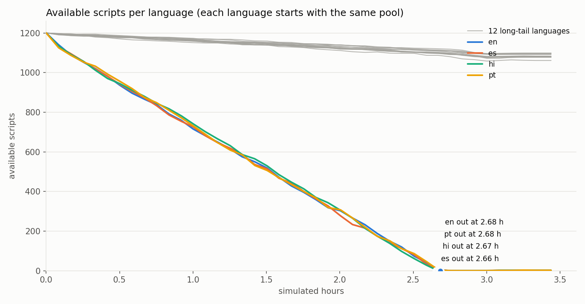

# Simulation results

Generated by `npm run sim` + `npm run check` on 2026-11-16. Every number below is measured from the run's database (`claim_events`, `recordings`, `scripts`, `pool_stats`) and the simulator's session log, not assumed.

## Summary

- **Setup:** 300 contributors online (of 2000 registered), 16 languages x 1200 scripts, 3.0 simulated hours against the real HTTP API (Next.js `start` + Postgres + MinIO). Time scale 60x: lease 600 s, heartbeat 30 s, job every 300 s (all simulated), claim order `fresh_first`. Seed 42.
- **Handed out twice:** **0 (pass)** overlapping leases across 7,267 lease intervals. **Recorded twice:** **0 (pass)**. Late submit accepted after someone else re-claimed: **0 (pass)**; late submit rejected although nobody else claimed: **0 (pass)**.
- **Vanished tabs:** script claimable again 9.99 min after the last heartbeat on average (p95 10.00), actually re-claimed after 32.07 min (p95 85.38; 29 of 154 not re-claimed before the run ended). **Polite release** (soft: the lease is shortened to a grace period, so another open tab of the same contributor can keep it): claimable 0.74 min after the release, re-claimed after 33.63 min (p95 109.14).
- **Late submits (network stall longer than the lease):** 265 accepted, 25 rejected because the script had been re-claimed; 743 contributor-minutes lost = $61.90 at $5/h.
- **Pool:** en ran out at 2.68 h, es ran out at 2.66 h, hi ran out at 2.67 h, pt ran out at 2.68 h; 918 distinct contributors hit "empty" (1,242 empty responses). 12 of 12 long-tail languages never ran out.
- **QA (lib/qa.ts, run during the sim):** of 6,951 submitted takes, 6,175 approved, 776 rejected (silent 348, too_short 234, distorted 194), 0 sent to human review, 0 still pending. 776 rejected scripts went back into the pool (666 were recorded again before the end).
- **Throughput:** 40.4 claims/s real (40.4 per simulated minute, peak 68.6), 2,025 submitted recordings per simulated hour. **318.0 approved audio hours = $1,586** payout at $5/approved hour (from approved recordings' `est_pay_cents`).

## 1. Handed out twice

For every claim token: live interval = [`claimed` at, latest `lease_expires_at` from its `claimed` / `heartbeat` / `resumed` events], cut short at its last `released` / `submitted` / `late_accepted` unless the token was revived afterwards (`resumed` with `detail.revived`). A revived token's interval spans the gap when it was expired or released: a revive only works while the row still carries that token, so another claim inside the gap would also be a violation. Any two different tokens whose intervals overlap on the same script is a violation. Timestamps are Postgres `now()` (microseconds), compared in SQL.

| Check | Result |
|---|---|
| Lease intervals checked | 7,267 |
| Overlapping intervals, raw timestamps | 0 |
| ... of which timestamp skew at releases (explained below, not double hand-outs) | 0 (max 0.0 ms real) |
| **Overlapping leases (double hand-outs)** | **0 (pass)** |
| Late submit accepted after another token claimed the script | **0 (pass)** |
| Late submit rejected although no other token had claimed the script | **0 (pass)** |
| live recording on unsubmitted script | **0 (pass)** |
| submitted script without recording | **0 (pass)** |
| recording token not claimed for script | **0 (pass)** |
| token claimed twice | **0 (pass)** |

## 2. Recorded twice

Scripts with more than one non-rejected recording: **0 (pass)**. Enforced by the partial unique index `one_live_recording_per_script`; this check confirms it from the data.

Session-level checks from the simulator's log:

| Behavior check | Result |
|---|---|
| Refresh mid-session got the same script back (status `resumed`, same token) | 465/465 |
| Second tab got the same script as the first | 292/292 |
| Second tab's next heartbeat after the first tab submitted got 409 | 292/292 |
| Double submit (2 concurrent + 1 retry) produced exactly one recording, same id for all 3 | 241/241 |
| Heartbeating sessions that unexpectedly lost their lease | 0 |
| Sessions that started by getting an earlier lease back (`resumed`: live resume or revive) | 957 |
| Sessions with any unexpected HTTP error | 0 |

## 3. Recovery time

Simulated minutes. "Claimable" = when the claim query would hand the script out again (lease end; for a soft release, the end of its grace lease, RELEASE_GRACE_SECONDS = 1.5 x heartbeat by default). "Re-claimed" = the next `claimed` event on that script by another token, which also depends on demand in that language.

| | n | claimable: mean | p95 | re-claimed: mean | p50 | p95 | max | not re-claimed by end |
|---|---|---|---|---|---|---|---|---|
| Tab vanished, abandoned (from last heartbeat) | 154 | 9.99 | 10.00 | 32.07 | 20.44 | 85.38 | 125.16 | 29 |
| Polite release (from release) | 90 | 0.74 | 0.75 | 33.63 | 22.36 | 109.14 | 136.17 | 13 |

574 of 728 vanished leases weren't abandoned: the same contributor started a new session and got the same script back (resumed while live, or revived after expiry if nobody else had taken it). The simulator lets any idle contributor arrive next, including one whose tab just died. They are excluded from the vanished row; the same goes for polite releases the owner revived.

Total idle script-minutes from abandoned tabs (last heartbeat to re-claim, or to the end of the run): 5144. Claimable time is lease minus the time since the last heartbeat, so it can't exceed the lease (10 min). Re-claim is near-instant after that because the claim query takes the lowest free id first, and an expired lease is always below the frontier of never-claimed scripts. Per-token rows: recovery.csv.

## 4. Late submits

A stalled contributor submits after the lease ended without re-claiming first. The submit is accepted if nobody else claimed the script in the meantime (the token is still on the row or in `prev_token`), and rejected (409) otherwise. The checker verifies both directions: **0 (pass)** accepted after someone else claimed, **0 (pass)** rejected without anyone else claiming.

| | accepted late | rejected |
|---|---|---|
| Popular languages (en, es, hi, pt) | 195 | 25 |
| Long-tail languages (12) | 70 | 0 |
| **Total** | **265** | **25** |

Contributor time lost on rejected submits (claim to rejection): **742.8 minutes = $61.90** at $5/h. Per-token rows: late_submits.csv.

## 5. Pool over time

`pool_over_time.csv`: one row per language per background-job run (every 5 simulated minutes), from `pool_stats`. `hours_left_sim` is the job's forecast converted to simulated hours.

| Language | Popular | Scripts | Recorded at end (submitted + approved) | QA-rejected, returned to pool | Ran out (first "empty", sim h) | First 0-available snapshot (sim h) | Contributors who hit empty |
|---|---|---|---|---|---|---|---|
| en | yes | 1,200 | 1,200 | 137 | 2.68 | 2.75 | 221 |
| es | yes | 1,200 | 1,197 | 148 | 2.66 | 2.83 | 221 |
| hi | yes | 1,200 | 1,198 | 132 | 2.67 | 2.67 | 247 |
| pt | yes | 1,200 | 1,198 | 164 | 2.68 | 2.75 | 229 |
| ar |  | 1,200 | 120 | 14 | never | never | 0 |
| bn |  | 1,200 | 122 | 19 | never | never | 0 |
| de |  | 1,200 | 109 | 23 | never | never | 0 |
| fr |  | 1,200 | 139 | 19 | never | never | 0 |
| id |  | 1,200 | 106 | 16 | never | never | 0 |
| it |  | 1,200 | 102 | 17 | never | never | 0 |
| ja |  | 1,200 | 123 | 16 | never | never | 0 |
| ko |  | 1,200 | 103 | 16 | never | never | 0 |
| pl |  | 1,200 | 121 | 18 | never | never | 0 |
| sw |  | 1,200 | 117 | 9 | never | never | 0 |
| tr |  | 1,200 | 118 | 16 | never | never | 0 |
| vi |  | 1,200 | 102 | 12 | never | never | 0 |

918 distinct contributors got "no scripts left" at least once (1,242 empty responses in total). In the simulation, a contributor who hits empty reads the message for 2 simulated minutes and leaves; their slot is refilled by another random contributor, so demand from the popular languages keeps arriving after they run out.

Popular languages hold 80% of contributors but the same 1/16 of scripts each, so they run out first; the long tail has spare scripts the whole time. A QA rejection puts the script back as available, so a language that ran out can briefly have scripts again (the small bumps after run-out in the chart) until someone re-records them.

## QA

Each submitted take is downloaded, decoded and checked by `lib/qa.ts` (running alongside the simulation in a separate process, 2 loops, drained before this report). Approved takes are paid at `est_pay_cents`; rejected ones put the script back in the pool; borderline ones go to a human.

| Status | Recordings |
|---|---|
| approved | 6,175 |
| rejected | 776 |

Rejection reasons: silent 348, too_short 234, distorted 194. Review reasons: none.

Verdict by the kind of take the simulator uploaded (does QA catch what it should?):

| Uploaded take | approved | rejected |
|---|---|---|
| normal speech (165-200 s) | 6,175 | 0 |
| heavily clipped | 0 | 194 |
| near-silent | 0 | 348 |
| too short (2.2 s) | 0 | 234 |

Submit-to-decision time (real seconds, QA is not time-scaled): mean 1.2, p50 0.9, p95 3.4, max 5.3. Approved audio: 318.0 h = $1586.20; in review: 0.0 h = $0.00; rejected: 27.2 h (unpaid).

## 6. Throughput

| Metric | Value |
|---|---|
| Arrivals window | 3.00 simulated h = 180 real s |
| Claims (new leases) | 7,267 |
| Claims/s (real) | 40.37 |
| Claims per simulated minute (mean / peak 5-min) | 40.4 / 68.6 |
| Recordings not rejected by QA (incl. drain after arrivals stop) | 6,175 |
| Submitted recordings per simulated hour | 2,025 |
| Submitted audio hours (not rejected) | 318.0 |
| **Approved audio hours** | **318.0** |
| **Payout at $5/approved hour** (sum of approved `est_pay_cents`) | **$1586.20** |
| Storage at the production format (48 kHz 16-bit mono) | 109.9 GB (uploaded in the sim at 1000 Hz: 2.29 GB) |

| Simulated hour (by submit time) | Recordings | Approved | Approved audio hours | Approved payout $ |
|---|---|---|---|---|
| 0 | 2,289 | 2,022 | 104.2 | 519.58 |
| 1 | 2,400 | 2,144 | 110.4 | 550.77 |
| 2 | 2,149 | 1,909 | 98.3 | 490.11 |
| 3 | 113 | 100 | 5.2 | 25.74 |

Client-side request latency during the run (ms, measured by the simulator; one Next.js process + one Postgres on a laptop; this is not the load test):

| Endpoint | Requests | p50 | p95 | p99 | max | 5xx / network errors |
|---|---|---|---|---|---|---|
| heartbeat | 80,181 | 32.2 | 179.9 | 374.5 | 733 | 0 |
| claim | 10,223 | 34.0 | 179.6 | 367.0 | 623 | 0 |
| submit | 7,458 | 89.8 | 360.8 | 535.7 | 1027 | 0 |
| upload_url | 6,976 | 13.7 | 132.5 | 292.6 | 698 | 0 |
| put | 6,952 | 23.5 | 67.4 | 130.4 | 563 | 0 |
| release | 413 | 31.5 | 152.6 | 192.7 | 258 | 0 |

## Method

- 300 concurrent sessions; when one ends, a random idle contributor (uniform over the 2000 registered, so arrivals follow the registered language mix, ~80% popular) starts the next after an exponential gap (mean 0.25 sim-min). First arrivals are staggered over 5 sim-min.
- Behavior per session: normal 68%, vanish 10%, polite_release 5%, refresh 6%, two_tabs 4%, stall 4%, double_submit 3%. Session length lognormal, median 5 sim-min, sigma 0.5. Vanish / release / refresh happen at a uniform 10-90% of the planned session; the stall starts at 10-50% and lasts 1.1-2.5x the lease.
- Audio: real WAVs from `lib/wav.ts` at 1000 Hz (speech-like harmonics with a syllable-rate |sin|^0.7 envelope, 1.5-4 s phrases with 0.2-0.8 s pauses, ~0.5 s of room tone at each end): ~89% normal (12 variants, 165-200 s), 5% near-silent, 3% heavily clipped, 3% too short (2.2 s). Every upload perturbs a few samples and halves three random 1-3 s stretches, so QA's exact-hash and envelope-fingerprint duplicate checks see distinct takes. Sizes are reported at the production format (48 kHz).
- The background job (`runJob` from `lib/jobs.ts`) runs in the simulator process every 300 sim-s. After arrivals stop, in-flight sessions drain for up to 45 sim-min. Event-loop delay in the simulator: p99 14.5 ms, max 90 ms (timing skew bound).
- Reproducible: `npm run sim -- --seed 42` then `npm run check`. Each session's choices come from its own RNG stream (seed + session number); exact counts still vary slightly between runs because request interleaving depends on wall-clock timing.
