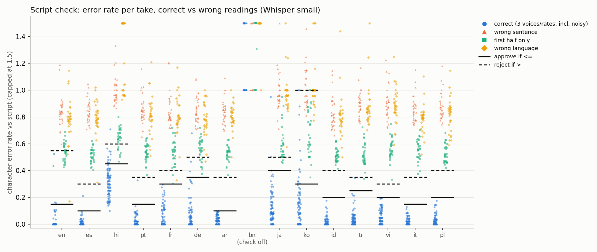

# Script check: did they read the script?

Generated by `npm run script-eval` (sim/script-eval.ts) against whisper.cpp `whisper-server` with ggml-small (multilingual) on this laptop (10-core Apple Silicon). 2580 synthesized takes: 15 languages x 30 sentences (Bengali 10) x 6 cases (3 correct, 3 wrong). Every take goes through the production path: a 48 kHz WAV with room tone at both ends -> lib/transcribe.ts -> lib/scriptmatch.ts.

**All numbers below are cross-validated**: each take is judged with thresholds chosen on the other half of that language's sentences (even vs odd), so no take is scored by thresholds fit to it. Bengali is excluded from the headline because the check is switched off for it (see below).

## Headline: script check alone

Without this check a person has to listen to every take to confirm it matches the script. With it, **only 3.1% go to review**, i.e. that share of all takes is still routed to a person (baseline: 100%), assuming 95% of takes are correct readings and 5% wrong (6.2% at this eval's 50/50 mix); **wrong readings caught: 90.2%** (9.6% sent to review, 0.2% slipped through); **correct readings wrongly rejected: 0.6%** (8 of 1260).

14 languages. Correct readings: 96.6% approved, 2.8% to review, 0.6% rejected (n = 1260). Wrong readings: 90.2% rejected, 9.6% to review, 0.2% approved (n = 1260). With the shipped thresholds (fit on all sentences, so optimistic): correct 97.0% / 2.8% / 0.2%, wrong 90.2% rejected / 9.8% / 0.0% approved. Counting Bengali as 100% review: 5.4% to review overall.

Transcription time per take: **p50 311 ms, p95 882 ms** (takes 5.2 s median, 7.6 s p95; one whisper-server, 4 threads, Metal; measured on the run that produced the cached transcripts). Bengali, had it not been switched off: p50 5388 ms. 0 transcription failures.

## QA overall (audio checks + script check)

What the whole QA step does with these takes: the audio checks (lib/checks.ts, with the options lib/qa.ts passes) combined with the script check exactly as the worker combines them. All 15 languages; for Bengali only the audio checks run. Shares of all takes as approved / sent to a person / rejected. Baseline without automatic QA: 100% to a person.

**QA overall, 95% correct / 5% wrong mix: 3.0% of all takes go to a person** (approved 91.9%, rejected 5.1%); before the script-aware audio rules: 33.5% to a person (approved 61.5%, rejected 5.0%). Correct readings alone: 96.7% / 2.7% / 0.6% (before: 64.7% / 34.7% / 0.6%). Wrong readings: 1.7% / 8.1% / 90.2% (before: 1.2% / 9.9% / 88.8%).

Why correct readings were not approved: script_mismatch 35, wrong_script 8 (before: too_short 425, script_mismatch 35, wrong_script 8, mostly_silent 8).

What changed (lib/checks.ts): "too short" is now judged against the script's expected reading time (letters at a per-language read-aloud pace, calibrated on these voices) instead of < 5 s, with absolute floors (< 1 s fails; without script text < 2 s fails, < 3 s review); "mostly silent" is measured between the first and last word, so room tone at the ends is left to the padding rule; and a take whose script check passed is not sent to review for being short (the transcript shows the whole text was read; hard fails and "too long" still count). On their own, the audio checks now pass 1290 of 1290 correct readings, so the waiver is a safety net for real fast readers, not what drives this number; and they flag 349 of 430 half readings (93 fail, 256 review) by length alone, which still protects Bengali and takes with no transcript. Regression: the synthetic silent / clipped / too short / padded / lengthened takes (scripts/qa-demo.ts) still fail, and the borderline ones still go to review.

| Lang | Correct takes: approved / review / rejected (before -> after) | 95/5 mix: to a person (before -> after) | 95/5 mix: rejected (before -> after) |
|---|---|---|---|
| en | 47.8% / 50.0% / 2.2% -> 96.7% / 1.1% / 2.2% | 47.9% -> **1.5%** | 6.7% -> 6.6% |
| es | 36.7% / 63.3% / 0.0% -> 98.9% / 1.1% / 0.0% | 60.2% -> **1.1%** | 4.9% -> 4.9% |
| hi | 54.4% / 44.4% / 1.1% -> 87.8% / 11.1% / 1.1% | 43.1% -> **11.4%** | 5.2% -> 5.2% |
| pt | 67.8% / 32.2% / 0.0% -> 98.9% / 1.1% / 0.0% | 30.7% -> **1.1%** | 4.9% -> 4.9% |
| fr | 40.0% / 60.0% / 0.0% -> 98.9% / 1.1% / 0.0% | 57.1% -> **1.2%** | 4.9% -> 4.8% |
| de | 74.4% / 24.4% / 1.1% -> 96.7% / 2.2% / 1.1% | 24.4% -> **3.0%** | 4.9% -> 5.2% |
| ar | 100.0% / 0.0% / 0.0% -> 100.0% / 0.0% / 0.0% | 0.1% -> **0.1%** | 4.9% -> 4.9% |
| bn (audio only) | 76.7% / 23.3% / 0.0% -> 100.0% / 0.0% / 0.0% | 24.5% -> **0.8%** | 0.0% -> 0.8% |
| ja | 82.2% / 15.6% / 2.2% -> 95.6% / 2.2% / 2.2% | 15.1% -> **2.4%** | 6.8% -> 6.8% |
| ko | 72.2% / 25.6% / 2.2% -> 86.7% / 11.1% / 2.2% | 27.2% -> **12.9%** | 4.2% -> 4.7% |
| id | 78.9% / 21.1% / 0.0% -> 96.7% / 3.3% / 0.0% | 20.2% -> **3.3%** | 4.9% -> 4.9% |
| tr | 81.1% / 18.9% / 0.0% -> 98.9% / 1.1% / 0.0% | 18.0% -> **1.1%** | 4.9% -> 5.0% |
| vi | 58.9% / 41.1% / 0.0% -> 100.0% / 0.0% / 0.0% | 39.1% -> **0.1%** | 4.9% -> 4.9% |
| it | 53.3% / 46.7% / 0.0% -> 97.8% / 2.2% / 0.0% | 44.3% -> **2.1%** | 5.0% -> 5.0% |
| pl | 53.3% / 46.7% / 0.0% -> 98.9% / 1.1% / 0.0% | 44.4% -> **1.2%** | 4.9% -> 4.9% |
| **all** | 64.7% / 34.7% / 0.6% -> 96.7% / 2.7% / 0.6% | 33.5% -> **3.0%** | 5.0% -> 5.1% |

## Per language (script check)

Cross-validated outcomes; thresholds are the shipped ones (fit on all sentences).

| Lang | Approve if CER <= | Reject if > | Correct: approved / review / **wrongly rejected** | Wrong: **rejected** / review / **wrongly approved** | Review at 5% wrong | Correct CER p50 / p95 / max | Wrong CER min / p5 | Thresholds per fold | Same with WER |
|---|---|---|---|---|---|---|---|---|---|
| en | 0.15 | 0.55 | 87 / 1 / **2** of 90 | **80** / 9 / **1** of 90 | 2% | 0 / 0.107 / 0.524 | 0.17 / 0.456 | 0.15/0.25, 0.2/0.55 | 2 / 1 / 2% |
| es | 0.1 | 0.3 | 89 / 1 / **0** of 90 | **89** / 1 / **0** of 90 | 1% | 0 / 0.067 / 0.211 | 0.31 / 0.452 | 0.1/0.3, 0.1/0.4 | 1 / 0 / 1% |
| hi | 0.45 | 0.6 | 79 / 10 / **1** of 90 | **72** / 18 / **0** of 90 | 12% | 0.308 / 0.522 / 0.708 | 0.467 / 0.552 | 0.45/0.6, 0.45/0.75 | 0 / 0 / 26% |
| pt | 0.15 | 0.35 | 89 / 1 / **0** of 90 | **88** / 2 / **0** of 90 | 1% | 0 / 0.093 / 0.328 | 0.367 / 0.472 | 0.35/0.45, 0.15/0.35 | 1 / 1 / 3% |
| fr | 0.3 | 0.4 | 89 / 1 / **0** of 90 | **87** / 3 / **0** of 90 | 1% | 0 / 0.224 / 0.297 | 0.302 / 0.426 | 0.25/0.35, 0.3/0.4 | 1 / 0 / 10% |
| de | 0.35 | 0.5 | 87 / 2 / **1** of 90 | **68** / 22 / **0** of 90 | 3% | 0.019 / 0.321 / 0.679 | 0.375 / 0.459 | 0.35/0.7, 0.35/0.5 | 2 / 1 / 9% |
| ar | 0.1 | 0.35 | 90 / 0 / **0** of 90 | **89** / 1 / **0** of 90 | 0% | 0.024 / 0.091 / 0.1 | 0.365 / 0.476 | 0.1/0.4, 0.1/0.35 | 1 / 0 / 5% |
| bn | check off | | correct readings: 30 of 30 have error >= 0.9 | | 100% if it were on | 1 / 1 / 1 (WER) | 1 | | |
| ja | 0.4 | 0.5 | 86 / 2 / **2** of 90 | **84** / 6 / **0** of 90 | 2% | 0.08 / 0.36 / 0.95 | 0.457 / 0.5 | 0.3/0.45, 0.4/0.5 | 0 / 0 / 97% |
| ko | 0.3 | 1 | 78 / 10 / **2** of 90 | **37** / 52 / **1** of 90 | 13% | 0.083 / 0.632 / 1 | 0.348 / 0.5 | 0.3/1, 0.4/0.85 | 0 / 2 / 33% |
| id | 0.2 | 0.4 | 87 / 3 / **0** of 90 | **88** / 2 / **0** of 90 | 3% | 0 / 0.068 / 0.176 | 0.414 / 0.469 | 0.1/0.45, 0.2/0.4 | 4 / 0 / 4% |
| tr | 0.25 | 0.35 | 89 / 1 / **0** of 90 | **89** / 1 / **0** of 90 | 1% | 0.018 / 0.178 / 0.347 | 0.34 / 0.449 | 0.25/0.35, 0.25/0.35 | 2 / 0 / 5% |
| vi | 0.2 | 0.3 | 90 / 0 / **0** of 90 | **88** / 2 / **0** of 90 | 0% | 0.024 / 0.147 / 0.196 | 0.333 / 0.5 | 0.2/0.45, 0.2/0.3 | 0 / 0 / 1% |
| it | 0.15 | 0.35 | 88 / 2 / **0** of 90 | **90** / 0 / **0** of 90 | 2% | 0 / 0.081 / 0.13 | 0.375 / 0.488 | 0.1/0.35, 0.15/0.35 | 1 / 1 / 7% |
| pl | 0.2 | 0.4 | 89 / 1 / **0** of 90 | **88** / 2 / **0** of 90 | 1% | 0 / 0.127 / 0.175 | 0.418 / 0.46 | 0.15/0.45, 0.2/0.4 | 1 / 0 / 3% |
| sw | 0.1 | never | untested: no TTS voice | | | | | | |

"Same with WER" = wrongly rejected / wrongly approved / review at 5% wrong, with the same procedure on word error rate.

## By case (cross-validated, all covered languages)

| Case | n | approved | review | rejected | CER p50 |
|---|---|---|---|---|---|
| correct | 420 | 413 | 6 | 1 | 0 |
| correct_slow | 420 | 416 | 3 | 1 | 0 |
| noisy_fast | 420 | 388 | 26 | 6 | 0.041 |
| wrong_script (wrong) | 420 | 0 | 12 | 408 | 0.873 |
| partial (wrong) | 420 | 1 | 90 | 329 | 0.544 |
| wrong_language (wrong) | 420 | 1 | 19 | 400 | 0.833 |

Correct readings wrongly rejected (8), what Whisper heard:

- en noisy_fast (Albert, 240 wpm, 17.4 dB SNR), CER 0.435: "I left my keys on the kitchen table next to the fruit bowl." -> "I left IT's application table next to the brutal"
- en noisy_fast (Albert, 240 wpm, 19.9 dB SNR), CER 0.524: "I would like a table for four near the window, please." -> "I would like to take one more point here to his home, please!"
- hi correct_slow (Lekha, 140 wpm), CER 0.708: "कुल मिलाकर आपका बिल चार सौ पचास रुपये का हुआ है।" -> "अगर अगर अगर अखर बिल्ख चार्सो पचास रुपे का हुए है"
- de noisy_fast (Flo (German (Germany)), 240 wpm, 15.6 dB SNR), CER 0.679: "Rühr die Suppe langsam um und lass sie noch zehn Minuten köcheln." -> "Ich werde die Zucht und die Lange machen und lass sie mit mir in die Küche."
- ja correct (Flo (Japanese (Japan))), CER 0.95: "今朝、湖のほとりで百羽以上の鳥を数えました。" -> "けさ、みずみのおとりで、ひゃくはねいりょうのとりをかぞえました。"
- ja noisy_fast (Eddy (Japanese (Japan)), 240 wpm, 18.5 dB SNR), CER 0.5: "今朝、湖のほとりで百羽以上の鳥を数えました。" -> "けさ、水海のお鳥で、百安井両の鳥を数えました。"
- ko noisy_fast (Flo (Korean (South Korea)), 240 wpm, 15.2 dB SNR), CER 1: "할머니께서는 집 뒤의 작은 텃밭에서 고추와 상추, 토마토를 기르세요." -> "(끝까지"
- ko noisy_fast (Flo (Korean (South Korea)), 240 wpm, 16.6 dB SNR), CER 0.88: "이층에 새로 들어온 프린터가 아직도 제대로 작동하지 않아요." -> "(이번에는 0을 맞추지 않습니다.)"

## Chosen thresholds and why

Per language, a grid search over approve-if <= p and reject-if > f with p, f in {0, 0.05, ..., 1.0} (f may be "never") and f >= p + 0.1 (a review band, so a take near the line goes to a person instead of being decided by 0.05), minimizing a cost of **20 per wrongly rejected correct reading, 10 per wrongly approved wrong reading, 1 per take sent to review**: a human listen is cheap, telling an honest contributor their take is wrong is the worst outcome, paying for a wrong take is next. Ties go to the thresholds farthest from the nearest misclassified take. **CER for every language**: it gave the fewest wrong rejections in cross-validation (it is not thrown off by Whisper splitting or joining words: German compounds, Korean spacing, Indic word breaks, Turkish suffixes, and gives partial credit for near-miss spellings), and one metric is simpler to explain. The WER column above is the comparison. These are the values shipped in `SCRIPT_THRESHOLDS` (lib/scriptmatch.ts).

| Lang | Approve if <= | Reject if > | Cost on all sentences |
|---|---|---|---|
| en | 0.15 | 0.55 | 23 |
| es | 0.1 | 0.3 | 1 |
| hi | 0.45 | 0.6 | 38 |
| pt | 0.15 | 0.35 | 1 |
| fr | 0.3 | 0.4 | 3 |
| de | 0.35 | 0.5 | 31 |
| ar | 0.1 | 0.35 | 0 |
| bn | check off | | |
| ja | 0.4 | 0.5 | 30 |
| ko | 0.3 | 1 | 89 |
| id | 0.2 | 0.4 | 0 |
| tr | 0.25 | 0.35 | 2 |
| vi | 0.2 | 0.3 | 0 |
| it | 0.15 | 0.35 | 0 |
| pl | 0.2 | 0.4 | 0 |

**Bengali: check off (review-only would be the alternative).** Whisper-small does not produce Bengali. Raw transcripts of correct readings are repetition loops in Telugu script (`వారిల్ల్ల్...`); on an unpadded clip it heard the words but wrote them in Devanagari. It is not the normalization (Bengali vowel signs and virama survive it; only nukta is folded, on both sides). A fixed generic Bengali prompt made it write Bengali script but the content stayed a loop (CER 1.5-2.2), and Whisper's temperature fallback produced random English / Telugu at ~7 s per take. Error ~1.0 for correct and wrong alike, ~5 s per take. With no signal, the check could only send every Bengali take to review, so it is switched off for bn (the take is decided on the audio checks, as before, and the skip is recorded in its checks). A larger Whisper model is the fix; see caveats.

**Swahili: untested** (no TTS voice). It gets approve if CER <= 0.1 and never rejects: a take that doesn't match closely goes to review.

## QA throughput with the check on

One QA worker (`runQaOnce`, batch 10), real Postgres + MinIO (own DB `sa_scriptcheck`), 8 takes per language x 15 languages, ~10% of them a different sentence (10 this run), each a TTS reading padded to >= 6 s at 48 kHz:

- check off: 120 takes in 1.9 s = **64.3 takes/s** (approved 98, rejected 0, review 22, errors 0); outcomes: (approved) 98, mostly_silent 21, near_duplicate 1
- check on: 120 takes in 37.0 s = **3.2 takes/s** (approved 86, rejected 9, review 25, errors 0); outcomes: (approved) 86, mostly_silent 22, wrong_script 9, script_mismatch 3
- transcription inside QA: p50 273 ms, p95 474 ms

Where the time goes (40 sentence takes, measured separately): Whisper ~300 ms per take on the GPU (Metal, flash attention on; the model loads once at server start, not per request). Resampling 48 -> 16 kHz in TS was ~100 ms per take until it got a precomputed-filter path (now ~8 ms). One server, one request at a time: 3.3 takes/s; 2 requests in flight: 3.4/s; two servers on ports 8178/8179 with -t 4 each, 2 in flight: 4.2/s. The GPU is the bottleneck, so a second server on the same laptop adds ~25%; a faster GPU or a smaller/quantized model is what would move it.

<!-- EXTRA -->

## How the check works

- `lib/transcribe.ts` resamples the 48 kHz take to 16 kHz mono in TS (windowed sinc) and POSTs it to `whisper-server` with the script's language forced. Greedy decoding at temperature 0 with Whisper's server-side fallback off; if the text is a repetition loop (Whisper's own test: compresses > 2.4x), one more decode at temperature 0.4. Timeout 30 s, one retry; on failure the check is skipped and recorded, never blocking QA.
- `lib/scriptmatch.ts` normalizes both texts (NFKC, lowercase, punctuation in every script, Arabic diacritics / letter variants, Indic nukta / chandrabindu) and computes WER, or CER over grapheme clusters. Scripts spell numbers out but Whisper writes digits, so a number in the transcript may stand for up to 4 words (8 characters) at no cost.
- `lib/qa.ts` runs the transcription before the per-hash duplicate lock and stores a `script_match` check (error rate, metric, thresholds, transcript, transcription ms). Fail -> reject `wrong_script`; between the thresholds -> review `script_mismatch`; combined with the audio checks like the others. Takes the audio checks already reject are not transcribed.

## Caveats

- **TTS is not people.** These are macOS voices: clean, regular, no accents, no hesitations, no kids, no cheap mics. Real contributors will have higher error rates on correct readings, so expect more review and some false rejects until thresholds are re-fit on a few hundred human-labeled real takes per language (the CSV format here works for that).
- **Few voices in some languages** (one voice for hi, ar, bn, id, tr, vi, pl): the slow / fast / noisy variants are the same speaker.
- **Thresholds come from 30 sentences per language** (180 takes, 15 per fold); the "thresholds per fold" column shows how much they move between halves. Cross-validation keeps the reported rates honest about that.
- **Swahili is untested** (no voice): review-only policy. **Bengali is not covered** (check off). A larger model (ggml-medium / large-v3) would likely fix Bengali and tighten Hindi and Korean, at roughly 3-10x the time per take; that is a model swap (`npm run whisper` points at the file) plus a re-run of this eval.
- **Expected reading time is calibrated on TTS** (slowed x0.7 to a typical read-aloud pace). A very fast human reader, or a script whose language reads faster than its letter count suggests, can land under 0.4x; with a passing script check that is waived, without one it goes to review. Children and slow readers land at 1-2x, far from the 3x review line.
- The wrong readings here are blunt (a whole other sentence, half a sentence, another language). Subtler errors (one skipped word, a misread number) mostly land in review or pass: at a WER pass threshold of p, a 12-word script tolerates floor(12 p) wrong words.
